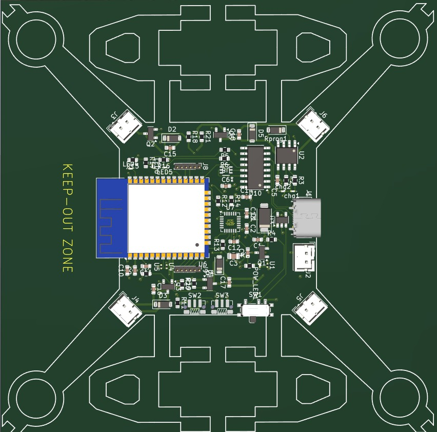
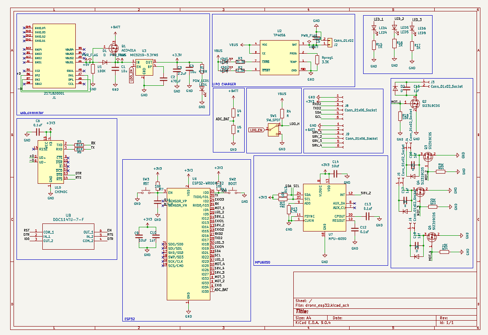
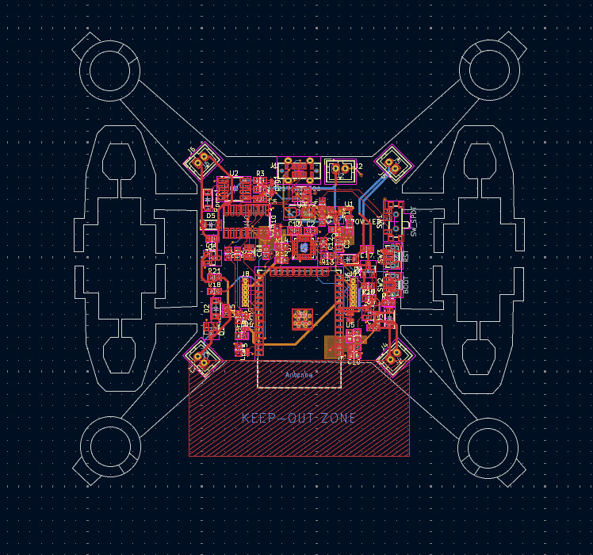

<div align="center">

# ESP32 Micro-Drone: the PCB *is* the frame

**A palm-sized quadcopter where the circuit board doubles as the airframe: ESP32 brain, MPU-6050 IMU, USB-C LiPo charging and four onboard brushed-motor drivers, all designed in KiCad 9.**




</div>

---

## The idea

No separate frame, flight controller or ESCs: the arms, motor mounts and electronics are one PCB. Plug in a 1S LiPo and four brushed motors, then fly it over Wi-Fi or Bluetooth from a phone or a second ESP32.

## Hardware at a glance

| Block | Part | Notes |
|---|---|---|
| MCU | **ESP32-WROOM-32** | Dual-core 240 MHz, Wi-Fi + Bluetooth, antenna keep-out respected |
| IMU | **MPU-6050** | 6-axis gyro + accel on I²C |
| Motor drivers | 4× **SI2319CDS** MOSFET channels + flyback diodes | One per brushed motor, PWM from the ESP32 |
| Charging | **TP4056** | Single-cell LiPo charging from USB-C, with charge / standby LEDs |
| 3.3 V | **MIC5219-3.3** LDO | |
| Protection | **AO3401A** P-MOSFET | Reverse-polarity / power-path on the battery |
| USB | USB-C + **CH340C** | Native USB-to-UART with auto-reset, so it flashes straight from Arduino IDE / ESP-IDF |
| I/O | 4 servo outputs, UART + I²C header, battery-voltage ADC, power switch, RST + BOOT buttons, 3 status LEDs | |

## Design files

<table>
<tr>
<td width="50%"><br/><sub><b>Schematic</b> (<a href="docs/schematic.pdf">PDF</a>)</sub></td>
<td width="50%"><br/><sub><b>PCB layout</b>, with the frame outline and antenna keep-out zone</sub></td>
</tr>
</table>

## Open it yourself

1. Install [KiCad 9](https://www.kicad.org/download/).
2. Clone the repo:
   ```bash
   git clone https://github.com/Prateek-elec/esp32-drone-flight-controller.git
   ```
3. Open `hardware/kicad/drone_esp32.kicad_pro`.

## Repository layout

```text
hardware/kicad/   KiCad project (.kicad_pro / .kicad_sch / .kicad_pcb)
docs/             Schematic PDF and images used in this README
```

## Roadmap

- [x] Schematic
- [x] PCB layout with integrated frame
- [ ] Gerbers + BOM for ordering
- [ ] Bring-up and hover test
- [ ] Firmware (ESP-Drone / custom PID loop) and phone control

## Contributing

Ideas, layout reviews and firmware help are welcome: [open an issue](https://github.com/Prateek-elec/esp32-drone-flight-controller/issues).

## License

[MIT](LICENSE) © Prateek Sarkar

<div align="center">

**Like the PCB-as-frame idea? Leave a ⭐ so more drone builders see it.**

</div>
